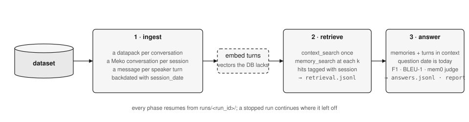
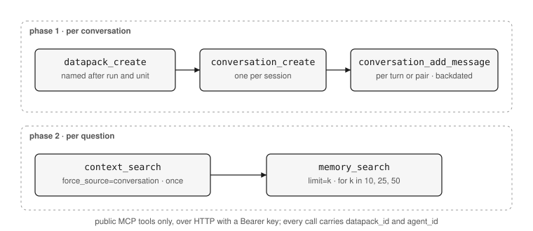
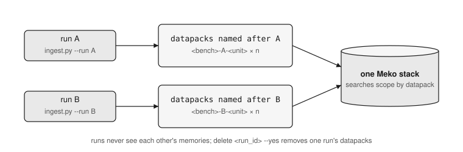

# LoCoMo pipeline

LoCoMo is 10 long two-person conversations (up to 35 sessions over months) and 1,986 questions about them, each tagged with a type and the turns that hold the answer.  
*The harness replays the conversations into Meko, asks the questions, and scores the answers.*

## The three phases



Each phase is resumable: a rerun skips turns already sent, questions already retrieved, rows already answered.

### 1 · Ingest



- Text sent: `[1:56 pm on 8 May, 2023] Caroline: …`, with shared photos as `[shared a photo: caption]`. The date is in the text and in the metadata, so the model later reads it and the store sorts by it.
- One Meko conversation per session, because Meko keeps a conversation as one Langfuse trace and a 400-turn trace crosses Langfuse's size limit.
- Turns are sequential within a conversation; `--workers` only parallelises across conversations.


### 2 · Retrieve

The question goes in verbatim. The conversation search is done once per question because the server ignores `limit` there. `--no-conversation` skips it.

### 3 · Answer and score

The model reads one block, in this order, and nothing else:

```
The following memories are presented in chronological order (oldest to newest).
(Monday, May 08, 2023) <memory>
…
The following are verbatim conversation turns from past sessions, oldest to newest.
[1:56 pm on 8 May, 2023] Caroline: <turn>
…
```

That block sits inside mem0's step-by-step answer prompt (categories 1 to 4) or the LoCoMo paper's short-answer prompt (adversarial, or all categories with `--prompt simple`). Prompts are verbatim in `benchmarks/locomo/prompts.py` and `score.py`.

`--prompt two-step` keeps mem0's reasoning and adds a second call that turns it into a phrase of at most six words in the words of the context, with one format rule per question type: a comma-separated list for multi-hop, a date or duration for temporal, one phrase for open-domain. The gold answers are three to six words, and F1 and BLEU-1 are word overlap, so a long answer scores low however right it is; the full run with mem0's prompt had 81% of the gold words present in single-hop answers of 24 words and scored F1 21. The reasoning call is where the accuracy comes from, so J should not move; the compression is what the token scorers see. The reasoning call's own answer is kept in `answers.jsonl` as `long_answer`.

On the full run (all 1,986 questions, gpt-5.6-terra answers, the Mem0 paper's judge on gpt-4.1) the two-step prompt took F1 at k = 25 from 21.0 to 64.6 on single-hop, 26.7 to 47.1 on multi-hop, 27.2 to 62.9 on temporal and 11.9 to 41.4 on open-domain, with B1 moving the same way, while J stayed within a few points of the old answers except on temporal (83.8 to 79.1). The paper's own short-answer prompt lands close on single-hop and lower elsewhere. The rows are in [comparisons.md](comparisons.md); `runs/locomo/full-twostep` and `full-simple` on VM2 hold the answers.


| score           | what it is                                                                                | where        |
| --------------- | ----------------------------------------------------------------------------------------- | ------------ |
| F1              | token overlap with the gold answer after normalising and stemming; the paper's function   | `score.py`   |
| B1              | BLEU-1, unigram precision with brevity penalty                                            | `score.py`   |
| J               | share of answers an LLM judge marks CORRECT; mem0's judge prompt; not run for adversarial | `prompts.py` |
| Gold in context | share of the gold answer's words present anywhere in the retrieved block                  | `report.py`  |
| Session R@k     | share of the question's evidence sessions represented by a retrieved memory or turn       | `report.py`  |


Per-type rules: multi-hop averages F1 over comma-separated gold parts, open-domain scores only the text before the first `;`, adversarial counts as correct when the answer says "no information available".

## Question types


| category | type        | count | example                                                          |
| -------- | ----------- | ----- | ---------------------------------------------------------------- |
| 4        | single-hop  | 841   | What did the charity race raise awareness for?                   |
| 1        | multi-hop   | 282   | What did Caroline research?                                      |
| 2        | temporal    | 321   | When did Melanie paint a sunrise?                                |
| 3        | open-domain | 96    | What fields would Caroline be likely to pursue in her education? |
| 5        | adversarial | 446   | a question whose answer is not in the conversation               |


## Run isolation



Every run ingests its own datapacks, so runs never see each other's memories and can be deleted independently with `./ingest.py --run <run_id> --delete`.

## Underlying scripts

These scripts live in `benchmarks/locomo/`; each runs on its own and resumes from `runs/<run_id>/`.

```bash
./ingest.py --run <run_id> --smoke              # 3 turns of conv-26, then verifies the stored date is 2023
./ingest.py --run <run_id> --workers 2          # phase 1; --conversations 0,3 for a subset; --images drop to skip photo captions
./retrieve.py --run <run_id> --ks 10,50,200     # phase 2; mem0 publishes at 200
./answer.py --run <run_id> --prompt simple      # phase 3 with the paper's short-answer prompt
./answer.py --run <run_id> --prompt two-step --per-category 40   # trial of the compressed answers on 200 questions
./report.py --run <run_id>                      # tables only
python3 baseline.py --mode fullcontext --conversations 1 --limit 20   # no-Meko ceiling: whole conversation in context
python3 baseline.py --mode rag --top-k 10 --dry-run                   # no-Meko floor: naive chunk retrieval
```

Shared photos become `[shared a photo: caption]` in the turn text (`--images caption`, the default), so the answer model sees what was shown without an image model in the loop.